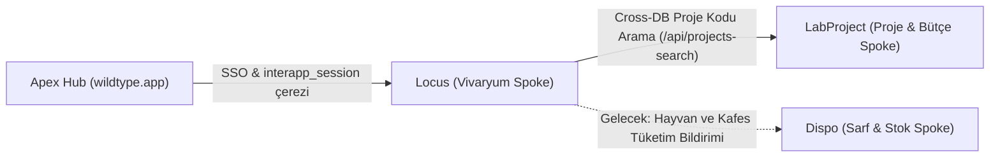

# Locus (Vivaryum Dijital İkizi) - Mimari Tasarım ve Vizyon Belgesi (Blueprint)

Bu doküman, **Locus** platformunun ürün vizyonunu, mimari felsefesini, domain (iş mantığı) kurallarını, ekosistem entegrasyonlarını ve geçmişten geleceğe tüm geliştirme fazlarını (Roadmap) tanımlar.

---

## 1. Ürün Vizyonu ve Felsefesi

Modern biyomedikal araştırmalarda, transgenik hayvan modelleri ve vivaryum operasyonları son derece yüksek maliyetli, regülasyona tabi ve hassas süreçlerdir. Fiziksel dünyada yüzlerce raf ve binlerce kafeste barınan canlıların konumu, suş özellikleri, etik onay kodları ve sağlık durumları çoğu zaman izole elektronik tablolarda (Excel) veya manuel kartoteks sistemlerinde tutulmakta; bu durum veri kaybına, mükerrer maliyetlere ve izlenebilirlik krizlerine yol açmaktadır.

**Locus**, laboratuvar hayvanı üretim, karantina ve barındırma tesislerinin **birebir dijital ikizini (digital twin)** oluşturmak amacıyla tasarlanmıştır.

### 1.1 Temel Tasarım İlkeleri (Core Philosophy)
1. **Fiziksel Gerçekliğe Birebir Sadakat:** Locus üzerindeki her sanal nesne, fiziksel tesisin laboratuvar zeminindeki somut karşılığıdır. Koordinatlar, raf katları ve kafes yuvaları laboratuvardaki gerçek metriklerle örtüşür.
2. **Yapısal Güvenlik ve Rol Ayrımı:** Vivaryumun yapısal bütünlüğü (Odaların inşası, Rafların satın alınıp kurulması, raf matris boyutlarının belirlenmesi) yalnızca Tesis Yöneticileri (`admin`) tarafından yönetilir. Günlük araştırmacı ve veteriner teknisyenleri (`user`) ise sadece kafes ve hayvan hareketliliğini yönetir.
3. **Ekosistem Sinerjisi (Antigravity Hub & Spoke):** Locus yalıtılmış bir ada değildir. Apex Hub ile kimliklenir, **LabProject** ile araştırma izinlerine bağlanır ve **Dispo** modülüne tüketim/deney kotası verisi sağlayacak ortak dili konuşur.

---

## 2. Vivaryum Alan Modeli (Domain Hierarchy)

Locus, 4 katmanlı katı bir hiyerarşik piramit üzerinde çalışır:

```
[ Tesis / Odalar (Rooms) ]
        │
        ▼
   [ Raflar (Racks) ]  ─── (Boyut: Rows x Cols Matrisi)
        │
        ▼
  [ Kafesler (Cages) ] ─── (Koordinat: Satır[A-Z] / Sütun[1-N])
        │
        ▼
 [ Hayvanlar (Animals) ] ── (Tür, Suş, Cinsiyet, Adet, Proje Kodu)
```

### 2.1 Katmanların Sorumlulukları
- **Oda (Room):** Fiziksel ve biyolojik izolasyon sınırıdır. Havalandırma ve biyogüvenlik seviyelerini temsil eder.
- **Raf (Rack):** IVC (Individually Ventilated Cages) veya klasik havalandırmalı raf üniteleridir. Matris yapısına sahiptir (Örn: 7 kat, her katta 10 yuva = 70 kafes kapasitesi).
- **Kafes (Cage):** Bir rafın belirli bir satır (`row`) ve sütun (`column`) kesişimine yerleştirilmiş mikro-çevredir. Benzersiz barkod/RFID etiketine sahip olabilir.
- **Hayvan (Animal Group):** Bir kafeste barınan aynı suş, cinsiyet ve doğum tarihine sahip birey veya grup kaydıdır.

---

## 3. Temel İş Mantığı ve Domain Kuralları

1. **Alfanümerik Koordinasyon Kuralı:**
   - Dikey koordinat (Satırlar) numerik 1-26 olarak saklanır, arayüzde `A-Z` harfleriyle gösterilir (`1 -> A`, `2 -> B`, `26 -> Z`).
   - Yatay koordinat (Sütunlar) `1-50` arası tamsayı olarak saklanır ve gösterilir.
   - Örnek slot etiketi: `C-B3` (2. satır, 3. sütun kafesi).
2. **Kafes Çakışma Yasağı (Slot Exclusivity):**
   Bir rafın belirli bir `(row, column)` hücresine aynı anda birden fazla kafes yerleştirilemez. Sunucu, bu tür girişimleri atomik sorgu ile engeller (`400 Bad Request`).
3. **Sınır Dışı Kafes Engeli (Boundary Protection):**
   Kafes koordinatları bağlı olduğu rafın `rows` ve `cols` değerlerini aşamaz.
4. **Kritik Raf Boyutu Koruma Kuralı:**
   Bir rafın satır veya sütun sayısı küçültüleceği zaman (`PUT /api/racks`), yeni sınırların dışında kalan aktif bir kafes varsa küçültme işlemi derhal durdurulur ve kullanıcıya o kafesi boşaltması/taşıması gerektiği bildirilir.
5. **Derin Bütünlük ve Kaskat Silme (Cascading Delete Policy):**
   Bir üst varlık silindiğinde, altındaki hiçbir varlık veritabanında "yetim (orphan)" bırakılamaz:
   $$\text{Oda Silinirse} \implies \text{Raflar} \implies \text{Kafesler} \implies \text{Hayvanlar Silinir}$$
   $$\text{Raf Silinirse} \implies \text{Kafesler} \implies \text{Hayvanlar Silinir}$$
   $$\text{Kafes Silinirse} \implies \text{Hayvanlar Silinir}$$

---

## 4. Ekosistem Entegrasyonları



- **Apex Entegrasyonu:**
  - Tek oturum (SSO). Kullanıcı `Apex` üzerinden oturum açtığında, `.wildtype.app` üst alan adına yazılan `interapp_session` çerezi Locus tarafından otomatik olarak tanınır.
  - Uygulama bazlı yetki kontrolü (`apps: ['locus']`).
- **LabProject Entegrasyonu:**
  - Canlı hayvanların kafeslere girişinde araştırmacının etik kurul veya proje kodunu manuel girmesi yerine, `LabProject_db.projects` koleksiyonundan anlık ReDoS korumalı aramayla doğrulanmış proje kodları seçilir.

---

## 5. Yol Haritası ve Faz Durumları (Roadmap)

### 📌 Faz 1: Temel Altyapı, Veri Modeli ve Güvenlik (Tamamlandı ✅)
- [x] MongoDB `Locus_db` koleksiyon mimarisinin (`rooms`, `racks`, `cages`, `animals`) tasarlanması.
- [x] Apex merkezi kimlik doğrulama mekanizması ve `interapp_session` JWT entegrasyonu.
- [x] Admin ve Standart Kullanıcı yetki ayrımı (RBAC).
- [x] İlişkisel bütünlüğü koruyan derin kaskat silme (Cascading Deletes) motoru.
- [x] Temel oda ve raf oluşturma arayüzü (`RoomRackManager.jsx`).

### 📌 Faz 2: Standardizasyon, Grid Kontrolleri ve Navigasyon (Tamamlandı ✅)
- [x] `react-router-dom` v7 modern yönlendirme yapısı (`/` ve `/navigator`).
- [x] Zod v4 ile backend uç noktalarında katı tip ve şema validasyonları.
- [x] Raf satır ve sütun sınır aşımı kontrol mekanizması (`row > rack.rows || column > rack.cols`).
- [x] Raf hücresi çakışma önleme (Slot overlap prevention) sistemi.
- [x] Raf küçültülürken sınır dışı kafes tespit ve engelleme algoritması (`outOfBoundsCage`).
- [x] 3 seviyeli akıcı Tesis/Oda/Raf/Kafes navigatörü (`Navigator.jsx`).
- [x] Yerel geliştirme için otomatik Bearer Token interceptor ve `lib/auth.js` geliştirici modu.
- [x] Cross-database LabProject proje arama API'si (`api/projects-search.js`).

### 🚀 Faz 3: Kafes Detay Çekmecesi (Drawer UI) ve Hayvan Yönetimi (Planlanan)
- [ ] Kafes Haritasında dolu bir kafese tıklandığında sağdan kayan detay çekmecesinin (Drawer UI) açılması.
- [ ] Çekmece içerisinde kafeste barınan hayvan gruplarının listelenmesi ve yeni hayvan ekleme formu.
- [ ] Hayvan ekleme formunda `api/projects-search` otomatik tamamlama entegrasyonu.
- [ ] Kafes durumunun dinamik değişimi (`Active`, `Karantina`, `Temizlikte`).
- [ ] Kafes bazlı QR/Barkod yazdırma (PDF / Termal etiket çıktısı).

### 🔮 Faz 4: İleri Seviye Özellikler ve IoT Entegrasyonu (Gelecek Vizyonu)
- [ ] **Sürükle-Bırak (Drag & Drop) Kafes Taşıma:** Kafeslerin raf üzerindeki boş slotlar arasında veya raflar arasında sürüklenerek transfer edilmesi.
- [ ] **Kafes Geçmişi ve Audit Log:** Bir kafesin veya hayvan grubunun tesis içerisindeki tüm yer değiştirme tarihçesinin zaman çizelgesiyle (timeline) izlenmesi.
- [ ] **IoT ve Çevresel İzleme:** Odaların sıcaklık, nem, hava değişim katsayısı (ACH) ve basınç sensörü verilerinin Locus Oda kartlarında gerçek zamanlı telemetri grafikleriyle gösterilmesi.
- [ ] **Dispo Entegrasyonu:** Kafes değişim periyotlarına göre otomatik altlık, yem ve suluk sarfiyatının Dispo stok modülünden düşülmesi.
